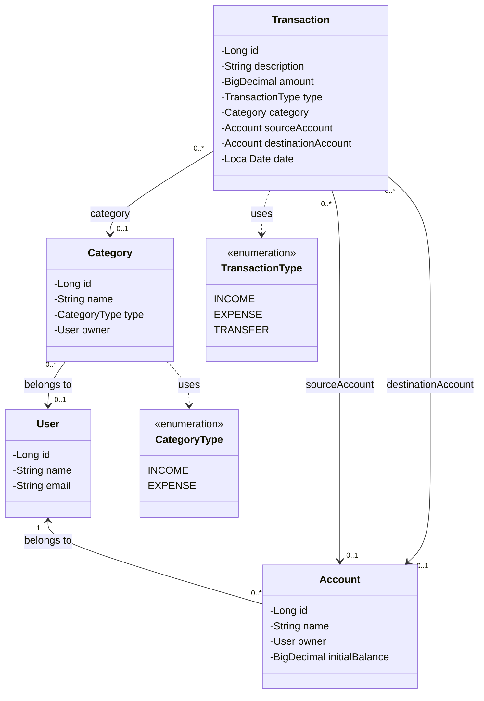

# Finance Manager - Domain Model

## 1. Category

### Description

Representa a classificação de receitas e despesas registradas no sistema.

### Attributes

| Attribute | Type | Description |
|---|---|---|
| id | Long | Identificador único da categoria |
| name | String | Nome da categoria |
| type | CategoryType | Define se a categoria pertence a receitas ou despesas |
| owner | User | Proprietário da categoria, quando personalizada |

### Business Rules

- Uma categoria deve possuir nome e tipo válidos.
- Categorias globais não possuem proprietário e ficam disponíveis para todos os usuários.
- Categorias personalizadas pertencem a um único usuário.
- Um usuário não pode modificar categorias globais nem categorias personalizadas de outros usuários.
- Receitas somente podem utilizar categorias do tipo `INCOME`.
- Despesas somente podem utilizar categorias do tipo `EXPENSE`.
- Transferências não utilizam categorias financeiras.
- Categorias vinculadas a transações não podem ser excluídas fisicamente, preservando o histórico financeiro.

## 2. Account

### Description

Representa uma conta financeira pertencente a um usuário, utilizada para registrar e acompanhar suas movimentações financeiras.

### Attributes

| Attribute | Type | Description |
|---|---|---|
| id | Long | Identificador único da conta |
| name | String | Nome definido pelo usuário |
| owner | User | Usuário proprietário da conta |
| initialBalance | BigDecimal | Saldo da conta no momento do cadastro |

### Business Rules

- Uma conta deve pertencer a um único usuário.
- O nome da conta não pode ser vazio.
- O saldo inicial deve ser informado no cadastro.
- O saldo atual deve ser calculado a partir do saldo inicial e das movimentações financeiras registradas.
- Receitas aumentam o saldo da conta de destino.
- Despesas diminuem o saldo da conta de origem.
- Transferências diminuem o saldo da conta de origem e aumentam o saldo da conta de destino.
- Transferências entre contas próprias não alteram o saldo consolidado do usuário.
- Um usuário não pode acessar ou movimentar contas pertencentes a outros usuários.
- O proprietário de uma conta não pode ser alterado após seu cadastro.
- Contas com transações vinculadas não podem ser excluídas fisicamente, preservando a integridade do histórico financeiro.

## 3. User

### Description

Representa um usuário cadastrado no Finance Manager, responsável por suas contas e informações financeiras.

### Attributes

| Attribute | Type | Description |
|---|---|---|
| id | Long | Identificador único do usuário |
| name | String | Nome do usuário |
| email | String | Endereço de e-mail utilizado para identificação e futuro login |

### Business Rules

- Cada usuário deve possuir um identificador único.
- O nome do usuário não pode ser vazio.
- O endereço de e-mail deve possuir formato válido e ser único no sistema.
- Um usuário pode possuir várias contas financeiras.
- Um usuário pode criar e gerenciar suas próprias categorias personalizadas.
- Categorias globais ficam disponíveis para todos os usuários.
- Um usuário somente pode acessar e movimentar contas de sua propriedade.
- A titularidade das transações deve ser identificada através das contas relacionadas.
- Transferências somente podem ocorrer entre contas pertencentes ao mesmo usuário.

## 4. Transaction

### Description

Representa uma movimentação financeira registrada no Finance Manager, podendo ser uma receita, despesa ou transferência entre contas próprias.

### Attributes

| Attribute | Type | Description |
|---|---|---|
| id | Long | Identificador único da transação |
| description | String | Descrição da movimentação financeira |
| amount | BigDecimal | Valor positivo da movimentação |
| type | TransactionType | Tipo da transação: INCOME, EXPENSE ou TRANSFER |
| category | Category | Categoria financeira, quando aplicável |
| sourceAccount | Account | Conta de origem da movimentação |
| destinationAccount | Account | Conta de destino da movimentação |
| date | LocalDate | Data da movimentação financeira |

### Business Rules

- Toda transação deve possuir identificador único.
- O valor (`amount`) deve ser maior que zero.
- Toda transação deve possuir um tipo válido.
- Toda transação deve possuir uma data válida.
- Receitas (`INCOME`) devem possuir conta de destino e categoria de receita, sem conta de origem.
- Despesas (`EXPENSE`) devem possuir conta de origem e categoria de despesa, sem conta de destino.
- Transferências (`TRANSFER`) devem possuir conta de origem e destino, sem categoria financeira.
- As contas de origem e destino de uma transferência devem ser diferentes.
- Transferências somente podem ocorrer entre contas pertencentes ao mesmo usuário.
- Todas as contas vinculadas a uma transação devem existir e pertencer ao usuário responsável pela operação.
- Categorias personalizadas utilizadas em transações devem pertencer ao usuário responsável pela operação.
- Receitas aumentam o saldo da conta de destino.
- Despesas diminuem o saldo da conta de origem.
- Transferências diminuem o saldo da conta de origem e aumentam o saldo da conta de destino.
- Transferências entre contas próprias não alteram o saldo consolidado do usuário.
- O saldo atual das contas deve refletir as movimentações financeiras registradas.
- A alteração ou exclusão de uma transação deve ser refletida nos cálculos de saldo.
- Os cálculos de saldo devem considerar apenas o estado atual das transações válidas, sem duplicar valores após alterações.

### Future Improvements

- Estornos vinculados às transações originais.
- Estornos parciais e múltiplos estornos.
- Transações recorrentes.
- Agendamento de movimentações financeiras.

## 5. Domain Class Diagram

